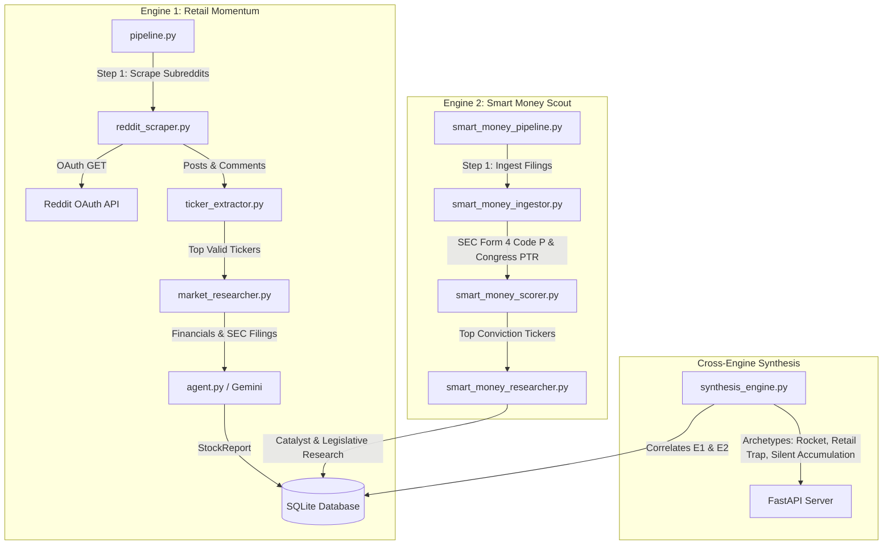

# Subreddit Stock Analyzer - Backend

This is the backend service for the Subreddit Stock Analyzer, an automated daily pipeline to discover trending stocks on a specified subreddit (e.g., r/wallstreetbets), perform AI-driven market research, and evaluate them for Buy/Hold/Sell signals.

## Architecture & Overview

- **Framework:** FastAPI (Python)
- **Dependency Management:** `uv`
- **Database:** SQLite (SQLAlchemy + aiosqlite) for local persistence
- **Scraping:** Official Reddit OAuth API (via `httpx.AsyncClient` with Client Credentials grant) querying multi-subreddit feeds (`r/wallstreetbets`, `r/stocks`, `r/ValueInvesting`) with authentic upvote scores, comment trees, and 100 req/min allowance. Strictly fails fast if credentials are missing or invalid.
- **Financial Data & Validation:** `yfinance` to validate candidate stock symbols (via price and market capitalization checks), fetch SEC filings, collect market metrics, and extract Form 4 insider transactions (`insider_purchases`, `insider_transactions`).
- **Web Search Integration:** `ddgs` (DuckDuckGo search) to fetch the latest industry/corporate news and Congressional/political STOCK Act trading disclosures.
- **AI/LLM:** Pydantic AI with Gemini 2.5 Pro (`gemini-2.5-pro`) to ensure structured outputs and enforce a strict "Default to HOLD" evaluation policy, blocking "BUY" recommendations if insiders are liquidating shares into retail hype.
- **Scheduling:** APScheduler to run the pipeline daily.

The application functions as a monolith containing both the `reddit-scraper` and `market-researcher` services. 
1. **Scraping & Extraction:** Scrapes top posts/comments, extracts potential stock symbols using regex (`$TICKER` or clean 2-5 letter uppercase words), and scores engagement.
2. **Validation:** Checks all candidates against `yfinance` to filter out non-stock uppercase noise (e.g. `OP`, `CNBC`, `CALLS`, `JUST`) and ETF/indices (e.g. `SPY`, `QQQ`), keeping exactly the top 5 valid stock securities.
3. **Researching:** Fetches key financial metrics, recent SEC filings (last 5 entries), news, latest web search news, Form 4 insider transactions, and Congressional trading disclosures for the 5 selected tickers.
4. **Evaluating:** Synthesizes the Reddit sentiment, SEC filings, news, and insider/Congressional data into a structured `StockReport` (enforcing that heavy insider selling blocks "BUY" ratings).
5. **Persisting:** Saves all validated tickers and structured intelligence reports to SQLite (`stock_analyzer.db`).
6. **Notifying:** Formats and dispatches a consolidated HTML daily market intelligence digest to Telegram via `telegram_notifier.py`.

### High-Level Data Flow



### Project Structure

```
backend/
├── app/
│   ├── agent.py                 # LLM agent for retail reports & trajectory analysis
│   ├── crud.py                  # Database CRUD for E1, E2, and Synthesis
│   ├── database.py              # DB connection & session creation
│   ├── llm_schemas.py           # Pydantic schemas (StockReport, Trajectory, SmartMoney)
│   ├── main.py                  # FastAPI application endpoints
│   ├── market_researcher.py     # yfinance & search wrapper for metrics and filings
│   ├── models.py                # SQLAlchemy models (E1, E2, Trajectory, Synthesis)
│   ├── pipeline.py              # Engine 1 pipeline runner
│   ├── reddit_scraper.py        # Multi-subreddit Reddit OAuth API client
│   ├── scheduler.py             # Daily APScheduler integration
│   ├── smart_money_ingestor.py  # Form 4 (Code P) and Congressional PTR ingestor
│   ├── smart_money_pipeline.py  # Engine 2 pipeline orchestrator
│   ├── smart_money_researcher.py# Legislative & turnaround catalyst researcher
│   ├── smart_money_scorer.py    # Multi-factor conviction scoring formula
│   ├── synthesis_engine.py      # Cross-engine market archetype classifier
│   ├── telegram_notifier.py     # Telegram Bot API client for daily digests
│   └── ticker_extractor.py      # Regex ticker extractor and engagement scorer
├── tests/                       # Unit test suites (35 tests passing)
```
├── pyproject.toml            # Project configuration and uv dependencies
├── run_pipeline.py           # Executable entry point to run pipeline manually
└── send_test_telegram.py     # CLI tool to test or manually dispatch today's digest
```

### Key Design Choices & Trade-offs

1. **Multi-Subreddit Reddit OAuth API Ingestion**:
   - *Choice*: Authenticate with Reddit's official API using Application-Only Client Credentials OAuth (`https://oauth.reddit.com`) to scrape top/hot posts and top comments across `r/wallstreetbets`, `r/stocks`, and `r/ValueInvesting`.
   - *Trade-off*: Requires developer registration (`REDDIT_CLIENT_ID` and `REDDIT_CLIENT_SECRET`), but provides genuine upvote scores, comment counts, upvote ratios, and up to 100 requests per minute (reducing scrape time from 20 minutes to under 10 seconds). Operates under a strict fail-fast posture with no unauthenticated fallback.
2. **yfinance Stock Validation Filtering**:
   - *Choice*: Tickers found by regex must have both a valid `currentPrice` (or `regularMarketPrice`) and a non-empty `marketCap` on `yfinance`.
   - *Trade-off*: Guarantees that the pipeline only analyzes and persists reports for actual tradeable stocks (filtering out index ETFs, crypto, options jargon, and noise), but adds validation latency during initial extraction.
3. **Default to HOLD Evaluation Posture**:
   - *Choice*: Prompt the Gemini model to assume a "HOLD" signal unless there is strong, corroborating evidence from both financial indicators and positive Reddit sentiment.
   - *Trade-off*: Mitigates meme-stock hype and provides conservative, realistic analysis at the cost of high-risk "buy" recommendations.

## Local Setup

### Prerequisites
- Python 3.11+
- `uv` installed (`pip install uv` or via standalone installer)

### Installation

1. Navigate to the `backend` directory.
2. Install dependencies:
   ```bash
   uv sync
   ```
3. Create a `.env` file in the `backend` directory with the following variables:
   ```ini
   # Reddit OAuth API Credentials (required)
   REDDIT_CLIENT_ID="your_reddit_client_id"
   REDDIT_CLIENT_SECRET="your_reddit_client_secret"
   REDDIT_USER_AGENT="python:stock-picker:v1.0.0 (by /u/stock-picker-bot)"
   # Optional: Subreddits to scrape (comma-separated, default: wallstreetbets,stocks,ValueInvesting)
   REDDIT_SUBREDDITS="wallstreetbets,stocks,ValueInvesting"
   
   GEMINI_API_KEY=your_gemini_api_key

   # Optional: Telegram Daily Digest Alerts (leave blank to disable)
   TELEGRAM_BOT_TOKEN="your_bot_token_from_botfather"
   TELEGRAM_CHAT_ID="your_telegram_chat_or_channel_id"
   ```

## How to Run

To run the FastAPI server (which also starts the daily scheduler):

```bash
uv run uvicorn app.main:app --reload
```
The API will be available at `http://localhost:8000`.
- Swagger UI: `http://localhost:8000/docs`
- PlainText Report endpoint: `http://localhost:8000/api/reports/{ticker}/text`
- Dashboard tickers: `http://localhost:8000/api/tickers/today` returns the **most recent pipeline run** (not the UTC calendar day, since UTC midnight is 08:00 SGT and the run is at 19:00 SGT).
- Historical Report Dates: `http://localhost:8000/api/reports/dates` returns all distinct execution dates.
- Reports by Date: `http://localhost:8000/api/reports?date=YYYY-MM-DD` returns reports generated on that calendar date.
- Tracked Tickers Catalog: `http://localhost:8000/api/analytics/tickers` lists all tickers with saved reports.
- Ticker Trajectory History: `http://localhost:8000/api/analytics/ticker/{ticker}` returns chronological run reports and price points.
- Trajectory Meta-Analysis: `POST /api/analytics/ticker/{ticker}/meta-analysis` synthesizes multi-day retail divergence and catalyst follow-through via Gemini (cached in SQLite).
- On-Demand Triggers: `POST /api/pipeline/trigger` (Engine 1) and `POST /api/smart-money/trigger` (Engine 2 + Synthesis).

### Running Pipelines & Resetting the Database via CLI

You can run individual engines, or completely reset the database and execute both pipelines end-to-end:

```bash
# Reset database and run Engine 1, Engine 2, and Cross-Engine Synthesis:
uv run python scripts/reset_and_run.py

# Only reset/clear the database without running pipelines:
uv run python scripts/reset_and_run.py --reset-only

# Run only Engine 1:
uv run python run_pipeline.py
```

### Querying Reports via CLI

You can query the SQLite database for a ticker report formatted directly to the console:

```bash
uv run python query_report.py <TICKER>
```
Example:
```bash
uv run python query_report.py NVDA
```

## How to Test

We use `pytest` for testing our ticker validations and LLM consistency:

```bash
uv run python -m pytest tests/
```
*(Note: Ensure you have `GEMINI_API_KEY` set to test against the live model).*
