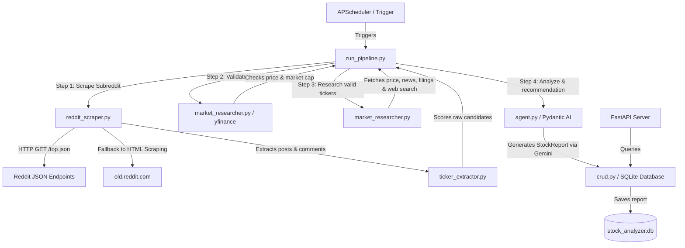

# Subreddit Stock Analyzer - Backend

This is the backend service for the Subreddit Stock Analyzer, an automated daily pipeline to discover trending stocks on a specified subreddit (e.g., r/wallstreetbets), perform AI-driven market research, and evaluate them for Buy/Hold/Sell signals.

## Architecture & Overview

- **Framework:** FastAPI (Python)
- **Dependency Management:** `uv`
- **Database:** SQLite (SQLAlchemy + aiosqlite) for local persistence
- **Scraping:** API-less JSON Endpoint Scraping (via `httpx`) falling back to an HTML scraper on `old.reddit.com` to bypass 403 Forbidden blocks.
- **Financial Data & Validation:** `yfinance` to validate candidate stock symbols (via price and market capitalization checks), fetch SEC filings, and collect market metrics.
- **Web Search Integration:** `ddgs` (DuckDuckGo search) to fetch the latest industry and corporate news (launches, tech advancements, product releases).
- **AI/LLM:** Pydantic AI with Gemini 2.5 Pro (`gemini-2.5-pro`) to ensure structured outputs and enforce a strict "Default to HOLD" evaluation policy.
- **Scheduling:** APScheduler to run the pipeline daily.

The application functions as a monolith containing both the `reddit-scraper` and `market-researcher` services. 
1. **Scraping & Extraction:** Scrapes top posts/comments, extracts potential stock symbols using regex (`$TICKER` or clean 2-5 letter uppercase words), and scores engagement.
2. **Validation:** Checks all candidates against `yfinance` to filter out non-stock uppercase noise (e.g. `OP`, `CNBC`, `CALLS`, `JUST`) and ETF/indices (e.g. `SPY`, `QQQ`), keeping exactly the top 5 valid stock securities.
3. **Researching:** Fetches key financial metrics, recent SEC filings (last 5 entries), news, and latest web search news for the 5 selected tickers.
4. **Evaluating:** Synthesizes the Reddit sentiment, SEC filings, news, and web search results into a structured `StockReport` (defaulting to "HOLD" on mixed signals).

### High-Level Data Flow



### Project Structure

```
backend/
├── app/
│   ├── agent.py              # LLM agent definition & structured stock evaluator
│   ├── crud.py               # Database CRUD operations
│   ├── database.py           # DB connection & session creation
│   ├── llm_schemas.py        # Pydantic schemas for Gemini structured outputs
│   ├── main.py               # FastAPI application definition and endpoints
│   ├── market_researcher.py  # Wrapper around yfinance for metrics, filings, and news
│   ├── models.py             # SQLAlchemy models
│   ├── reddit_scraper.py     # Custom HTTP scraper with old.reddit.com fallback
│   ├── scheduler.py          # Daily APScheduler integration
│   └── ticker_extractor.py   # Regex ticker extractor and engagement scorer
├── tests/                    # LLM behavior and validation test suites
├── pyproject.toml            # Project configuration and uv dependencies
└── run_pipeline.py           # Executable entry point to run pipeline manually
```

### Key Design Choices & Trade-offs

1. **Direct JSON Scraping & HTML Fallback**:
   - *Choice*: Fetch raw listings by appending `.json` to public Reddit URLs, falling back to a custom HTML scraper parsing `old.reddit.com` when blocked by 403 errors.
   - *Trade-off*: Bypasses OAuth setups and API credentials, but requires a strict rate-limit posture (polite sleeps of 1.5 seconds) to avoid blocks.
2. **yfinance Stock Validation Filtering**:
   - *Choice*: Tickers found by regex must have both a valid `currentPrice` (or `regularMarketPrice`) and a non-empty `marketCap` on `yfinance`.
   - *Trade-off*: Guarantees that the pipeline only analyzes and persists reports for actual tradeable stocks (filtering out index ETFs, crypto, options jargon, and noise), but adds validation latency during initial extraction.
3. **Default to HOLD Evaluation Posture**:
   - *Choice*: Prompt the Gemini model to assume a "HOLD" signal unless there is strong, corroborating evidence from both financial indicators and positive Reddit sentiment.
   - *Trade-off*: Mitigates meme-stock hype and provides conservative, realistic analysis at the cost of high-risk "buy" recommendations.

## Local Setup

### Prerequisites
- Python 3.11+
- `uv` installed (`pip install uv` or via standalone installer)

### Installation

1. Navigate to the `backend` directory.
2. Install dependencies:
   ```bash
   uv sync
   ```
3. Create a `.env` file in the `backend` directory with the following variables:
   ```ini
   # Custom agent to prevent aggressive Reddit blocks
   REDDIT_USER_AGENT="Mozilla/5.0 (Windows NT 10.0; Win64; x64) HermesAgent/1.1 (Autonomous Research Project)"
   
   GEMINI_API_KEY=your_gemini_api_key
   ```

## How to Run

To run the FastAPI server (which also starts the daily scheduler):

```bash
uv run uvicorn app.main:app --reload
```
The API will be available at `http://localhost:8000`.
- Swagger UI: `http://localhost:8000/docs`
- PlainText Report endpoint: `http://localhost:8000/api/reports/{ticker}/text`

### Running the Pipeline Manually

If you don't want to wait for the scheduler to trigger, you can run the pipeline directly:

```bash
uv run python run_pipeline.py
```

### Querying Reports via CLI

You can query the SQLite database for a ticker report formatted directly to the console:

```bash
uv run python query_report.py <TICKER>
```
Example:
```bash
uv run python query_report.py NVDA
```

## How to Test

We use `pytest` for testing our ticker validations and LLM consistency:

```bash
uv run python -m pytest tests/
```
*(Note: Ensure you have `GEMINI_API_KEY` set to test against the live model).*
