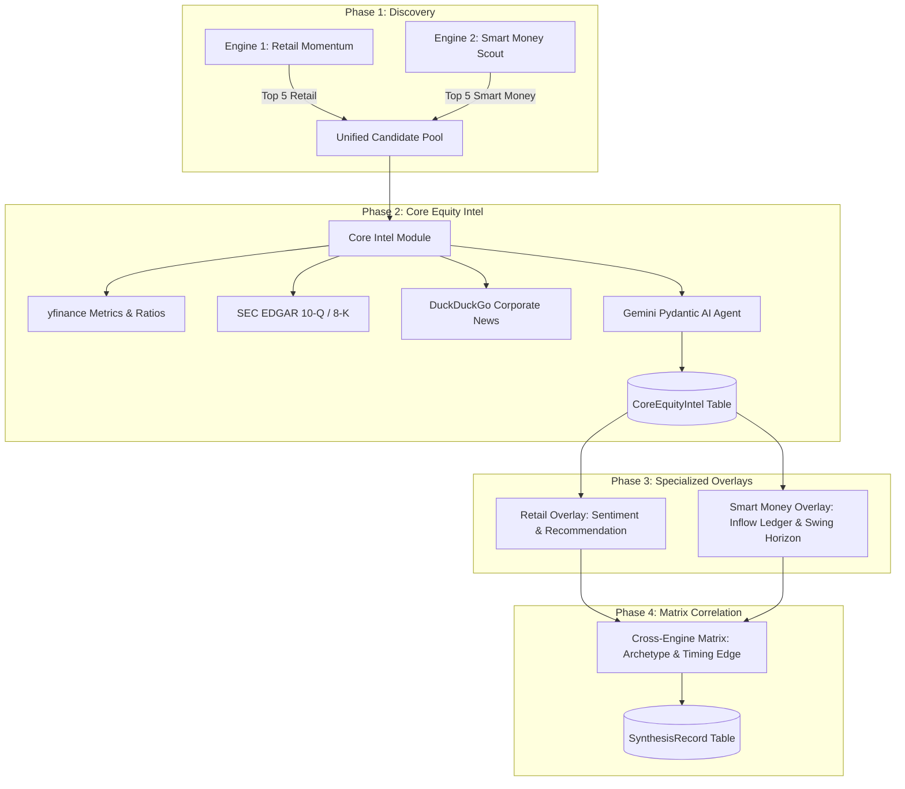

## Context

See `proposal.md` for the motivation and high-level requirements. Currently, Engine 1 stores reports in `ticker_reports` with four pillars (Ground Truth, Filings/News, Events, Risk, Recommendation), while Engine 2 stores reports in `smart_money_reports` with an Inflow Ledger and political catalyst text. These two schemas are isolated, preventing Smart Money picks from having fundamental ground truth or financial ratios, and preventing `/stats` from offering unified historical browsing.

## Goals / Non-Goals

**Goals:**
- Extract fundamental research into a reusable `core_intel_engine.py` that processes up to 10 unique candidate tickers (5 from Engine 1 + 5 from Engine 2) and saves `CoreEquityIntel` records.
- Refactor the data model to attach `RetailReport` and `SmartMoneyReport` as modular overlays referencing `CoreEquityIntel`.
- Enable a 3-tab historical archive view on `/stats` (`Retail Momentum`, `Smart Money & Gov`, `Synthesis Matrix`) with item count badges and clean empty states.
- Create a Unified Master Report on `/report/[ticker]` dynamically showing Core Fundamentals, Retail Momentum (or stealth notice), Smart Money Inflow (or no-cluster notice), and Synthesis Matrix diagnosis.
- Display an Archetype Lifecycle Progression timeline on `/analytics/[ticker]`.

**Non-Goals:**
- Modifying the underlying Reddit OAuth extraction or OpenInsider scraping algorithms.
- Changing the APScheduler 19:00 SGT cron schedule or Telegram notification channels.

## Architecture & Data Flow

## Decisions

### 1. Normalized Relational Schema (`CoreEquityIntel` + Overlays)
- **Decision**: Separate company fundamentals (`CoreEquityIntel`) from domain-specific signals (`RetailReport` and `SmartMoneyReport`).
- **Rationale**: If a ticker is discovered by both engines on the same day, the expensive SEC filings, news retrieval, and Gemini ground truth synthesis are executed exactly once. Every Smart Money pick gets full 4-pillar fundamental coverage.
- **Alternative considered**: Duplicating ground truth fields into `SmartMoneyReport`. Rejected because it duplicates Gemini calls, wastes tokens, and creates schema inconsistency.

### 2. Multi-Tab Client-Side State in `/stats`
- **Decision**: Keep a single date selector at the top of `/stats`, fetching all three datasets in parallel (`/api/reports?date=...`, `/api/smart-money/reports?date=...`, `/api/synthesis/reports?date=...`).
- **Rationale**: Instant tab switching without reload flicker, displaying exact count badges (`Retail (5)`, `Smart Money (5)`, `Synthesis (10)`).
- **Alternative considered**: Separate sub-routes (`/stats/retail`, `/stats/smart-money`, `/stats/synthesis`). Rejected because users comparing a specific run day benefit from instant switching within the same context.

### 3. Unified Master Report Route (`/report/[ticker]`)
- **Decision**: Consolidate individual stock viewing into `/report/[ticker]`. Route `/smart-money/[ticker]` will redirect or mirror this unified view.
- **Rationale**: Eliminates fractured UX where clicking a ticker in Synthesis led to different layouts. A single master view gives the complete picture: Fundamentals + Retail + Smart Money + Archetype.
- **Alternative considered**: Maintaining two separate report pages forever. Rejected because users constantly missed ground truth when on the smart money page.

## Risks / Trade-offs

- **[Risk] Increased Gemini API calls for Smart Money tickers**:
  - *Mitigation*: Core Intel runs on up to 10 unique tickers per day (at most 5 additional calls compared to before). Calls run asynchronously and can be batched with structured schema outputs.
- **[Risk] Schema Incompatibility with Previous DB State**:
  - *Mitigation*: Per user instruction, SQLite database is wiped and freshly regenerated using `reset_and_run.py`.

## Migration Plan

1. Update SQLAlchemy models in `backend/app/models.py`.
2. Implement `backend/app/core_intel_engine.py` to handle shared research and Gemini synthesis.
3. Update `backend/app/crud.py` with normalized CRUD operations and date queries.
4. Refactor `pipeline.py`, `smart_money_pipeline.py`, and `run_pipeline.py`.
5. Update FastAPI endpoints in `backend/app/main.py`.
6. Upgrade Next.js pages: `/stats`, `/report/[ticker]`, and `/analytics`.
7. Execute `uv run python scripts/reset_and_run.py` to wipe SQLite and run the new pipeline cleanly.

